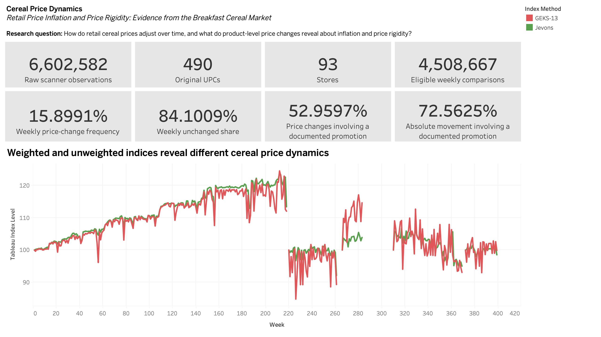
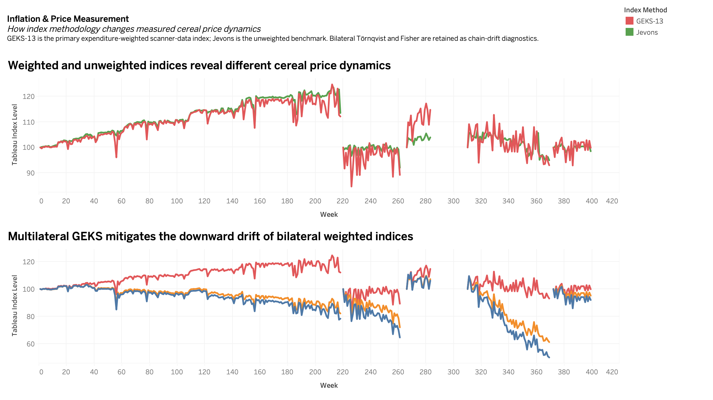
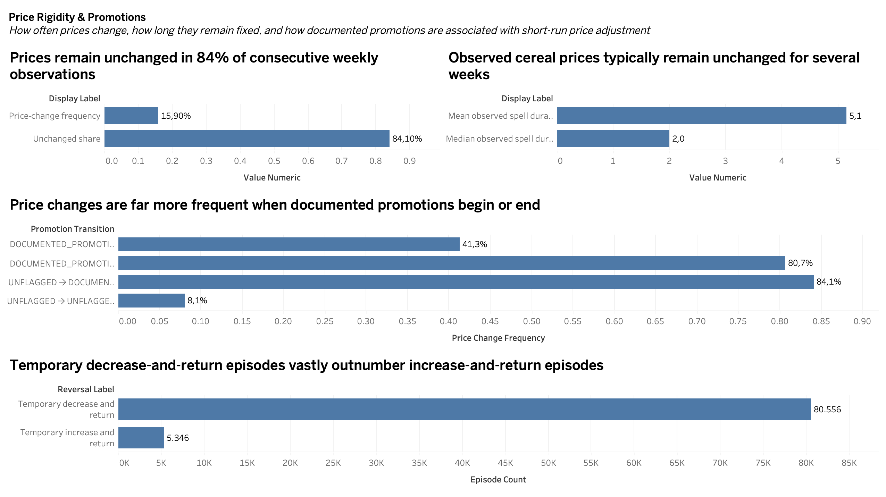
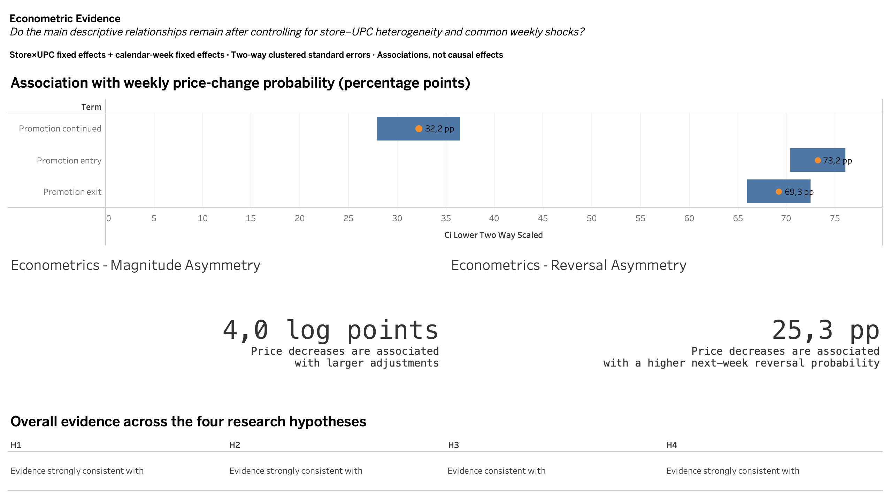

# Cereal Price Dynamics

## Project Overview
This project looks at weekly cereal prices using retail scanner data from the Dominick’s dataset. The data includes around 6.6 million observations from 93 stores and 490 product codes, so I was able to track the same products across stores and over time instead of relying only on an average price series. At the beginning, I mainly wanted to see how cereal prices moved from week to week, but the data turned out to be less about continuous price changes and more about price rigidity and temporary promotions. I looked at how often prices actually changed, whether increases and decreases behaved differently, and how documented promotion periods were related to short-term price movements. While building weighted price indices, I noticed another issue that became an important part of the project. Some chained indices showed a strong downward movement that did not line up with the simpler price measures. I went back through the calculations and checked whether this was an implementation problem, but the pattern seemed to come from temporary discounts interacting with changing sales weights. During promotion weeks, prices could fall while sales increased sharply, and when the price returned to its previous level the weights were no longer the same. This created a chain-drift problem in the bilateral weighted indices. I therefore used a rolling GEKS-Törnqvist index as the main weighted measure, while keeping Jevons and the bilateral indices for comparison and diagnostics. I do not interpret the promotion results as causal effects. The main aim is to describe how prices behave in the data and to show how temporary price movements and weighting choices can affect the way those movements are measured.

## Research Questions

The main question behind the project was how cereal prices actually change over time at store and product level, because looking only at one average price series can hide quite a lot of what is happening underneath. I broke this into a few smaller questions while working with the data: how often does the price of the same product in the same store change from one week to the next, are price increases and decreases similar in size and frequency, and how much of the short-term movement happens around documented promotion periods. I also wanted to know if the way prices are aggregated changes the overall picture. That became more relevant later, after some of the weighted chained indices started showing a much stronger downward movement than I expected. So another question was whether expenditure-weighted and unweighted price indices tells a different story about cereal price dynamics, especially when temporary discounts and changing sales weights are present. These questions are mostly descriptive, the project does not try to prove that promotions cause the observed price or quantity changes.

## Data

The project uses the cereal category from the Dominick’s Dataset published by the Kilts Center at the University of Chicago Booth School of Business. The raw movement file contains 6,602,582 weekly store-product observations and the product file contains 490 UPC records, with data coming from 93 stores. I kept the original files unchanged and built separate analytical samples from them because there were a few issues that needed to be handled first, including OK=0 records, zero prices, missing weeks and some products that were not actually cereal. Three T-shirt related UPCs were removed from the main cereal sample, and for the price analysis I only kept observations with valid price information. The effective unit price was calculated as PRICE / QTY, while expenditure was calculated as (PRICE × MOVE) / QTY. After the cleaning steps, the core cereal price sample had 4,706,611 observations. For week-to-week price comparisons I only compared the same store and UPC when the weeks were exactly consecutive, so gaps in the calendar was not treated as a normal weekly change. This left 4,508,667 eligible consecutive price comparisons. The panel is not balanced and some weeks are completely missing, so I did not connect price changes across those gaps later in the analysis.

## Methodology

The workflow covers source auditing, analytical sample construction, price-index measurement, price-rigidity and promotion analysis, and fixed-effects econometrics. Effective unit price is defined as PRICE / QTY and expenditure as (PRICE × MOVE) / QTY. All weekly comparisons require the same store and UPC in exactly consecutive calendar weeks; missing weeks are never bridged.

The primary expenditure-weighted price measure is the rolling 13-week GEKS-Törnqvist index. Jevons is retained as the unweighted benchmark, bilateral Törnqvist and Fisher as chain-drift diagnostics, and GEKS-26 and a Laspeyres-style index as robustness checks. The econometric models use store×UPC and calendar-week fixed effects with two-way clustered standard errors by store–UPC and week. All promotion results are interpreted as associations rather than causal effects.

## Key Findings

- Prices were unchanged in 84.10% of the 4,508,667 eligible consecutive weekly comparisons; 15.90% changed.
- Documented promotions were involved in 52.96% of observed price changes and 72.56% of total absolute price movement.
- The mean observed price spell was about 5.15 weeks and the median was 2 weeks.
- There were 80,556 temporary decrease-and-return episodes and 5,346 temporary increase-and-return episodes.
- Relative to UNFLAGGED→UNFLAGGED, documented-promotion entry was associated with a 73.22 percentage-point higher weekly price-change probability, continuation with 32.21 percentage points and exit with 69.26 percentage points.
- Price decreases were associated with absolute changes around 3.97 log points larger than increases and a 25.32 percentage-point higher next-week reversal probability.
- Rolling GEKS-Törnqvist substantially reduced the long-run downward drift visible in the bilateral weighted indices in most segments.

## Price Index and Chain Drift

The price-index part ended up being one of the more unexpected parts of the project. At first I calculated Jevons together with bilateral Törnqvist and Fisher indices, expecting the weighted measures to give a somewhat different but still comparable picture. Instead, the bilateral weighted indices showed a much stronger downward movement over several of the continuous time segments. For example, in weeks 1–218 the Jevons index ended at 113.43 while the bilateral Törnqvist ended at 82.15 and Fisher at 78.35. That gap was large enough that I did not want to treat it as just a normal weighting difference.

I checked the implementation separately and the bilateral Törnqvist calculations matched the independent validation almost exactly, so the problem was not coming from the index formula itself. The pattern was more related to how prices and expenditure shares changed around temporary discounts. When a product went on promotion, its price could fall while the quantity sold increased sharply, so the lower price received a relatively large expenditure weight. When the price later returned to its previous level, the sales weight was often lower again. Repeating this across many products and weeks can make chained bilateral indices drift downward even when the underlying price path does not show the same long-run fall.

I used a 13-week rolling GEKS-Törnqvist index after finding this issue. It compares weeks through a multilateral structure rather than relying only on one chain of adjacent bilateral comparisons, which made it less exposed to the repeated promotion-weight pattern. The GEKS-13 index was treated as the main expenditure-weighted series, while Jevons stayed as the unweighted benchmark. Bilateral Törnqvist and Fisher were kept in the analysis mostly because they were useful for showing where the chain-drift issue appeared rather than being removed after the problem was found. A 26-week GEKS version and a Laspeyres-style index were also used as robustness checks.

The data has missing calendar weeks, so I did not create one continuous index across the full sample. Five uninterrupted segments were calculated and each one starts again from 100. GEKS-13 ended at 112.07 in the first segment, 89.30 in the second, 114.66 in the third, 93.06 in the fourth and 99.86 in the fifth. The exact direction was not the same in every period, but compared with the bilateral weighted indices the long-run downward drift became much smaller in most of the segments.

## Econometric Results

The descriptive results already showed a strong connection between documented promotions and weekly price changes, but I wanted to check whether the same pattern remained after controlling for persistent differences between products and stores. I estimated fixed-effects models with store×UPC fixed effects and calendar-week fixed effects, using two-way clustered standard errors at the store–UPC and week level. The reference group was UNFLAGGED→UNFLAGGED. Relative to that group, entering a documented promotion was associated with a 73.22 percentage-point higher probability of a weekly price change, while staying in promotion was associated with 32.21 percentage points and leaving a promotion with 69.26 percentage points. These are large differences, although I do not treat them as causal effects of promotions.

I also used the price-change sample to look at the size of adjustments. After the fixed effects were included, price decreases were associated with absolute price changes around 3.97 log points larger than increases. Price changes involving a documented promotion were also associated with larger adjustments, by about 11.42 log points in the model. The direction was similar to what I had already seen in the descriptive results, so the basic asymmetry was not disappearing once store-product differences and common weekly shocks were controlled for.

The reversal model gave another useful result. Conditional on a price change and having an eligible following week, a decrease was associated with a 25.32 percentage-point higher probability of reversing in the next week compared with an increase. Documented-promotion involvement was associated with another 6.86 percentage points. I also checked alternative clustering, excluded unknown promotion transitions and removed the most extreme 0.1% of price changes; the main coefficient directions stayed the same. The models therefore supports the descriptive picture, but they still describe associations in this dataset rather than identifying why a retailer chose a particular price.

## Dashboard Guide

### Dashboard 1 — Research Overview



**KPI Summary**  
The first section gives a quick scale of the project before going into the detailed analysis. It shows 6,602,582 raw scanner observations, 490 original UPC records, 93 stores and 4,508,667 eligible consecutive weekly price comparisons. The other four KPIs summarize some of the main results: 15.90% of weekly prices changed, 84.10% stayed unchanged, documented promotions were involved in 52.96% of observed price changes and 72.56% of total absolute price movement. I used these cards mostly so someone opening the dashboard can understand the size of the data and the main pattern without reading the methodology first.

**GEKS-13 vs Jevons Price Index**  
The line chart compares the main expenditure-weighted GEKS-13 index with the unweighted Jevons benchmark. The two measures sometimes move in a similar direction, but they do not always give the same cumulative price path. Missing calendar weeks are left as gaps rather than connecting separate periods, so the chart is split into continuous segments. The gap between the two series gives a quick sense of how much the weighting choice can matter for the final price path.

---

### Dashboard 2 — Inflation & Price Measurement



**GEKS-13 vs Jevons**  
The first chart repeats the comparison between GEKS-13 and Jevons, but here the purpose is more about measurement than giving a general project overview. GEKS-13 uses expenditure information while Jevons gives products equal treatment in the aggregation. Differences between the two are therefore not automatically errors; they show that product weights matter. The gap is not equally large in every segment either, which was one reason I avoided describing the result with one single full-sample inflation number.

**Chain Drift Diagnostics — GEKS, Törnqvist and Fisher**  
This was probably the most useful chart for understanding the index problem I found. Bilateral Törnqvist and Fisher sometimes fall much more sharply than GEKS-13, especially over longer sequences of weeks. In the first segment, for example, GEKS-13 finishes around 112 while bilateral Törnqvist ends close to 82 and Fisher falls below 79. Those differences were too large to ignore. After checking the calculations, I linked much of this pattern to temporary discounts combined with changing expenditure weights. GEKS does not remove every difference, but the extreme cumulative downward drift becomes much smaller in most segments.

---

### Dashboard 3 — Price Rigidity & Promotions



**Changed vs Unchanged Prices**  
This chart is the simplest picture of price rigidity in the project. Out of more than 4.5 million valid consecutive price comparisons, 84.10% were unchanged and only 15.90% changed. So most cereal prices in the dataset were not being adjusted every week. Even though the chart is simple, the 84.10% unchanged share sets up most of the later analysis on price rigidity.

**Price Spell Duration**  
Here I looked at how long the same observed price continued before changing. The mean observed spell was about 5.15 weeks, while the median was 2 weeks. That difference means there were many short price spells but also some much longer periods that pull the average upward. These are observed durations rather than exact retailer pricing cycles, since some spells are censored by missing data or the beginning and end of the sample.

**Promotion Transition Price-Change Frequency**  
This chart compares four different promotion transitions. UNFLAGGED→UNFLAGGED observations had a price-change frequency of only about 8.1%. Once a documented promotion started, it increased to around 84.1%, and when a promotion ended the frequency was still very high at about 80.7%. Even during DOCUMENTED_PROMOTION→DOCUMENTED_PROMOTION transitions, around 41.3% of prices changed. The difference between these groups was one of the clearest indications that short-run price adjustment was concentrated around documented promotion periods. `UNFLAGGED` should not be read as confirmed non-promotion, since the promotion coding is incomplete.

**Temporary Price Reversals**  
The reversal chart compares decrease-and-return episodes with increase-and-return episodes. I found 80,556 temporary decreases compared with only 5,346 temporary increases. The size of that difference is much easier to see in the chart than in a table. It also fits with the earlier finding that decreases were much more likely than increases to reverse in the following week, and many of these episodes were connected with documented promotions.

---

### Dashboard 4 — Econometric Evidence



**Promotion Transition Coefficients**  
The main coefficient chart shows the fixed-effects estimates for promotion transitions relative to UNFLAGGED→UNFLAGGED observations. Entering a documented promotion was associated with a 73.2 percentage-point higher probability of a weekly price change, promotion continuation with 32.2 percentage points and promotion exit with 69.3 percentage points. The horizontal ranges show the two-way clustered confidence intervals. These estimates already control for store×UPC fixed effects and calendar-week fixed effects, so persistent store-product differences and common weekly shocks are removed from the comparison. I still interpret the coefficients as associations, not causal effects.

**Magnitude Asymmetry**  
The smaller card on the left summarizes the difference between price increases and decreases once a price change has occurred. Decreases were associated with absolute adjustments about 4.0 log points larger than increases after the fixed-effects controls were included. This matches the descriptive result where decreases were less frequent than increases, but tended to be larger when they happened.

**Reversal Asymmetry**  
This card looks at what happens after a price change. A decrease was associated with a 25.3 percentage-point higher next-week reversal probability compared with an increase. For me this is one of the useful results because it separates a temporary price cut from a normal permanent-looking price adjustment. That difference also makes the temporary nature of many price decreases much clearer than looking at the average price change alone.

**Hypothesis Summary**  
The final panel gives a compact summary of the four original hypotheses. H1, about price rigidity, was strongly consistent with the evidence. H2, concerning the role of documented promotions in short-run price movements, was also strongly consistent. H3, which compared weighted and unweighted price measurement, was supported but with more mixed evidence across periods, so I kept the wording as “consistent” rather than “strongly consistent.” H4, covering the asymmetry between increases and decreases, was strongly consistent with the descriptive and regression results.

## Limitations

The weekly store-level data is detailed, but there are still several things in the dataset that make some results harder to interpret cleanly. First, the promotion variable is incomplete. A blank or UNFLAGGED observation does not necessarily mean that no promotion was taking place, it only means there was no documented promotion code in that observation. Because of this I avoided calling the UNFLAGGED group “regular price” or treating it as a clean non-promotion sample. There are also a small number of unknown promotion codes, and I kept them separate instead of forcing them into one of the main groups.

The panel is unbalanced and some calendar weeks are completely missing. I did not connect observations across these gaps, which is why the price indices are shown in separate continuous segments instead of one full uninterrupted series. Price spells have a similar issue. Around 34% of the observed spells are censored, so the average spell duration should be read as an observed duration in this dataset, not as the exact amount of time retailers normally keep a price unchanged.

Another limitation is that the data covers one retailer and one product category. Cereal has a relatively promotion-heavy pricing structure, so the same price-change frequencies or reversal patterns may look different in categories where promotions are less common. The dataset is also historical, which means the results describe the pricing environment in this sample rather than current U.S. retail pricing.

The econometric models control for store×UPC differences and common weekly shocks, but they are still observational. Promotion decisions, prices and quantities can move together, and there may be other factors that are not observed in the dataset. For that reason I use words such as “associated with” throughout the project and do not interpret the coefficients as causal effects. The price indices have a similar boundary: they are research measures for this cereal sample, not an official consumer price index or a measure of overall U.S. inflation.

## Repository Structure

```text
README.md             project overview, findings and dashboard guide
requirements.txt      Python dependencies
config/               versioned product-universe exclusions
data/README.md        source-data access and public-data policy
docs/                 methodology and validation documentation
notebooks/            final reproducible analysis notebooks
src/                  reusable analysis scripts
tableau/              final workbook, aggregate dashboard data and screenshots
```

## Technologies

Python  
pandas  
NumPy  
SciPy  
statsmodels  
Matplotlib  
Tableau  
Git / GitHub
